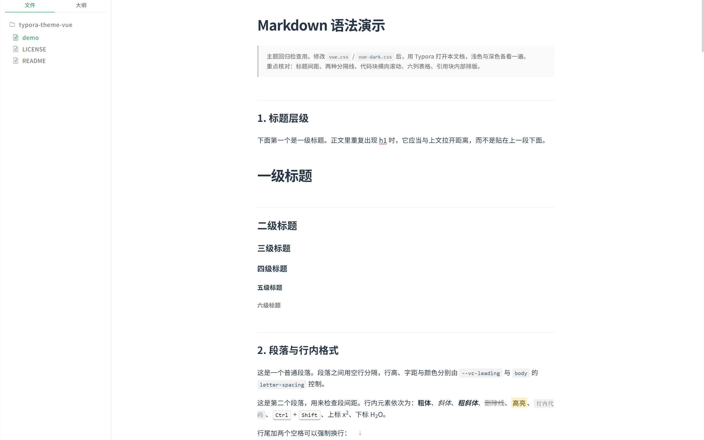
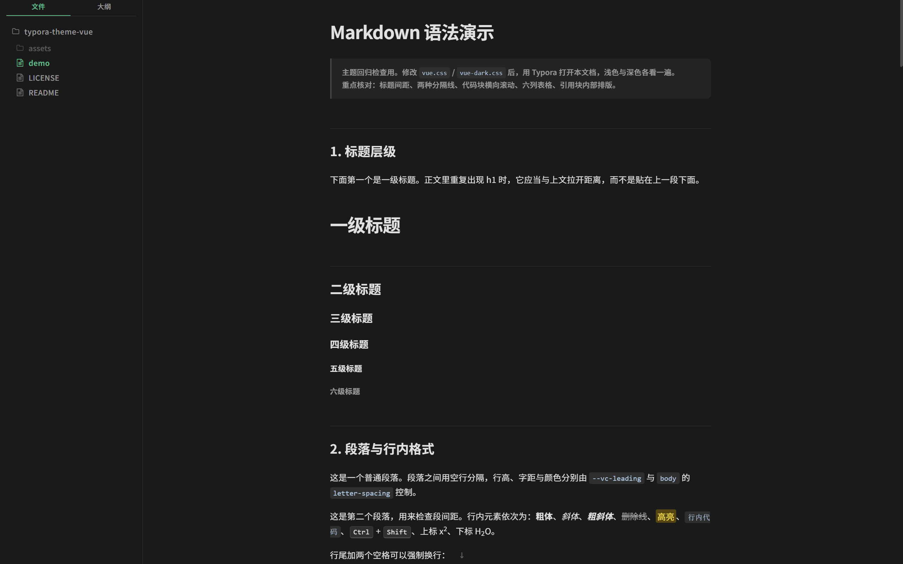
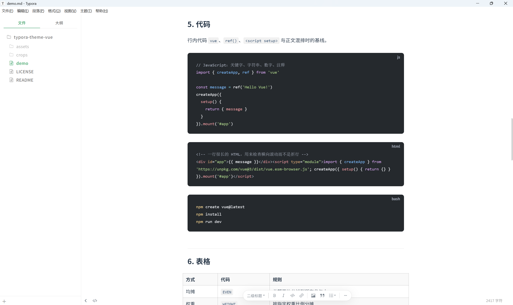
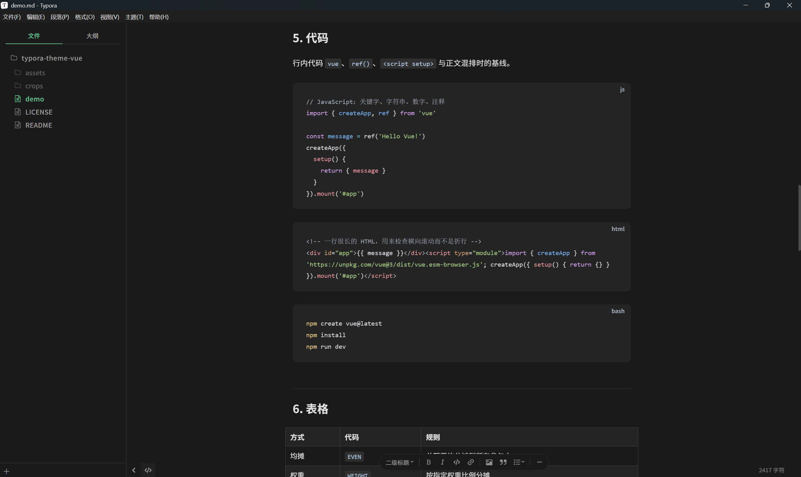

# Typora Vue 主题

适用于 Typora 的 Vue 风格主题，提供浅色和深色两种配色：

- [vue.css](vue.css)：浅色
- [vue-dark.css](vue-dark.css)：深色

## 预览

| 浅色 | 深色 |
| :---: | :---: |
|  |  |
|  |  |

## 安装

1. 下载需要的 CSS 文件（浅色、深色可以只取其一）。
2. 打开 Typora：**文件 → 偏好设置 → 外观 → 打开主题文件夹**。
3. 把 CSS 文件复制进该文件夹。
4. 重启 Typora（或重新打开偏好设置）。
5. 在 **偏好设置 → 外观 → 主题** 中选择对应主题。

安装后的目录结构：

```text
Typora/themes/
├── vue.css
└── vue-dark.css
```

## 许可

[MIT](LICENSE)
