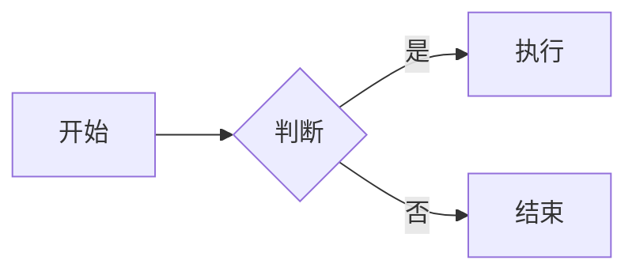

# Markdown 语法演示

> 主题回归检查用。修改 `vue.css` / `vue-dark.css` 后，用 Typora 打开本文档，浅色与深色各看一遍。
> 重点核对：标题间距、两种分隔线（含紧贴二级标题的情形）、代码块横向滚动、表格的两列与四列同宽、五列外扩、六列长表头折行、九列横向滚动、数字列对齐、引用块内部排版、markdown 围栏取色。

## 1. 标题层级

下面第一个是一级标题。正文里重复出现 h1 时，它应当与上文拉开距离，而不是贴在上一段下面。

# 一级标题

## 二级标题

### 三级标题

#### 四级标题

##### 五级标题

###### 六级标题

## 2. 段落与行内格式

这是一个普通段落。段落之间用空行分隔，行高、字距与颜色分别由 `--vc-leading` 与 `body` 的 `letter-spacing` 控制。

这是第二个段落，用来检查段间距。行内元素依次为：**粗体**、*斜体*、***粗斜体***、~~删除线~~、==高亮==、`行内代码`、<kbd>Ctrl</kbd> + <kbd>Shift</kbd>、上标 x^2^、下标 H~2~O。

行尾加两个空格可以强制换行：  
这一行与上一行同属一个段落，检查行距是否一致。

## 3. 列表

- 无序列表第一项
- 第二项，带行内代码 `npm install`
  - 第二层
    - 第三层
- 第四项

1. 有序列表第一项
2. 第二项
3. 第三项

任务列表：

- [x] 已完成的任务
- [ ] 未完成的任务
- [ ] 另外一条比较长的任务，用来检查换行之后的行距与缩进是否对齐

## 4. 引用

> 单层引用，检查字号、字重、底色、圆角与左侧竖线。
>
> 第二段，检查引用内部多段之间是否留出间距。

> 外层引用
>
> > 嵌套引用，检查底色加深与缩进层级。

> 引用里的代码块：
>
> ```js
> const message = 'Hello'
> ```

## 5. 代码

行内代码 `vue`、`ref()`、`<script setup>` 与正文混排时的基线。

```js
// JavaScript：关键字、字符串、数字、注释
import { createApp, ref } from 'vue'

const message = ref('Hello Vue!')
createApp({
  setup() {
    return { message }
  }
}).mount('#app')
```

```html
<!-- 一行很长的 HTML，用来检查横向滚动而不是折行 -->
<div id="app">{{ message }}</div><script type="module">import { createApp } from 'https://unpkg.com/vue@3/dist/vue.esm-browser.js'; createApp({ setup() { return {} } }).mount('#app')</script>
```

```bash
npm create vue@latest
npm install
npm run dev
```

```markdown
# Markdown 语法演示

这是一份演示 Markdown 常用语法的文档。

## 二级标题

### 三级标题

- **粗体**、*斜体*、~~删除线~~、`行内代码`
- [Vue 快速上手](https://cn.vuejs.org/guide/quick-start.html)

> 引用与分隔线一并检查取色。

---
```

## 6. 表格

| 方式 | 代码 | 规则 |
| --- | --- | --- |
| 均摊 | `EVEN` | 总额平均分摊到所有参与人 |
| 权重 | `WEIGHT` | 按指定权重比例分摊 |

四列的表格与正文同宽，左边缘应当和上面的段落、以及本节第一张表格齐平：

| 列 1 | 列 2 | 列 3 | 列 4 |
| --- | --- | --- | --- |
| 内容 | 内容 | 内容 | 内容 |

两列的表格同样占满正文宽度，不因为内容少就缩成一块孤岛：

| 参数 | 说明 |
| --- | --- |
| `--vc-measure` | 正文栏宽，43em，16px 下约 688px |
| `--vc-page-pad` | 左右内边距，同时也是表格外扩的上限 |

五列起触发加宽逻辑，左边缘会比正文各向外伸出 32～64px（窗口很窄时退回内边距的宽度）：

| 列 1 | 列 2 | 列 3 | 列 4 | 列 5 |
| --- | --- | --- | --- | --- |
| 内容 | 内容 | 内容 | 内容 | 内容 |

极端表头（压力用例）：六列表头都超过十个字时，表头应当折成两行、两行长度接近，
而不是把整张表撑出滚动条；折行后表格总宽仍不超过 816px：

| 组件名称与版本编号信息 | 作用与适用场景的详细说明 | 默认取值与可选项 | 使用条件与生效范围 | 补充说明与注意事项 | 当前状态与验收结论 |
| --- | --- | --- | --- | --- | --- |
| 表格外扩 | 五列及以上借用左右留白 | 32px | 宽表格 | 编辑区够宽时放宽到 64px | 已实现 |

数字列按等宽字形排，位数相同的数字（如 128.4 与 211.8）应当逐位对齐：

| 模块 | P50 (ms) | P95 (ms) | 请求量 |
| --- | ---: | ---: | ---: |
| 首页 | 128.4 | 512.66 | 120345 |
| 详情页 | 96.75 | 431.2 | 8932 |
| 结算 | 211.8 | 803.05 | 1042 |

七列及以上解除 64px 外扩封顶，随编辑区宽度铺开（左右保留 24px 边距）；内容仍超出编辑区宽度时，再在表格容器内横向滚动：

| 列 1 | 列 2 | 列 3 | 列 4 | 列 5 | 列 6 | 列 7 | 列 8 | 列 9 |
| --- | --- | --- | --- | --- | --- | --- | --- | --- |
| 内容 | 内容 | 内容 | 内容 | 内容 | 内容 | 内容 | 内容 | 内容 |

宽指标表（七列，行内代码表头 + 多行首列）：铺满编辑区展示，表头与单元格里的短代码保持单行不劈断，多行首列时同行数字垂直居中：

| 模型 / 变体 | 输入侧信息 | `TAB_ROC` | `TAB_AP` | `TAB_R-PR` | `TAB_VUS-ROC` | `TAB_VUS-PR` |
| --- | :---: | ---: | ---: | ---: | ---: | ---: |
| `CrossAD` *(NeurIPS 2025)* | 纯 `X` | 0.7478 | 0.3908 | 0.3866 | 0.7411 | 0.3840 |
| `EquiBreak v2.2`（历史含 `u_exo`） | `X + u_exo` | **0.7870** | **0.4580** | **0.4381** | 0.7620 | **0.4356** |
| `A0_PureX_Base`（**v2.2 去 `u_exo`**） | **纯 `X`** | 0.7860 | 0.4576 | 0.4370 | 0.7583 | 0.4325 |

## 7. 链接与图片

正文链接：[Vue 快速上手](https://cn.vuejs.org/guide/quick-start.html)、[相对链接](#6-表格)。检查默认颜色与 hover。


## 8. 分隔线

上面是段落，下面是一条 `---`。

---

下面是分隔线之后的内容。`---` 是作者主动画的断点，用 `--vc-divider`，比 h2 的线深一档。

有些文档习惯用 `---` 切分章节，让分隔线紧贴下一个二级标题（本节与第 9 节之间就是这种写法）。h2 的线在下边框，两条线分处标题上下，不需要互斥规则，`---` 也始终可见、可点、可选中。

---

## 9. 数学公式

行内公式 $E = mc^2$ 与 $\sum_{i=1}^{n} i = \frac{n(n+1)}{2}$。

$$
\int_{-\infty}^{\infty} e^{-x^2}\,\mathrm{d}x = \sqrt{\pi}
$$

再放一个很宽的公式，检查是横向滚动还是溢出正文：

$$
f(x) = a_0 + a_1 x + a_2 x^2 + a_3 x^3 + \cdots + a_n x^n + \frac{1}{1 + e^{-x}} + \sum_{k=0}^{\infty} \frac{x^k}{k!}
$$

## 10. 脚注

这里引用一个脚注[^1]，再引用第二个[^2]。

[^1]: 脚注内容与角标，检查字号、底色与缩进。
[^2]: 第二条脚注。

## 11. 目录

[TOC]

## 12. Mermaid 与原始 HTML



<div style="padding: 12px 16px; border: 1px solid #ddd; border-radius: 8px;">
  原始 HTML 块：检查字体、行高与边框是否跟随主题。
</div>

## 13. GitHub Alert

> [!NOTE]
> 提示块，检查标签与左侧竖线是否跟随代码块色板。

> [!WARNING]
> 警告块，检查深色下的强调色是否清晰。

> [!CAUTION]
> 危险块，检查红色是否与正文、链接区分得开。
