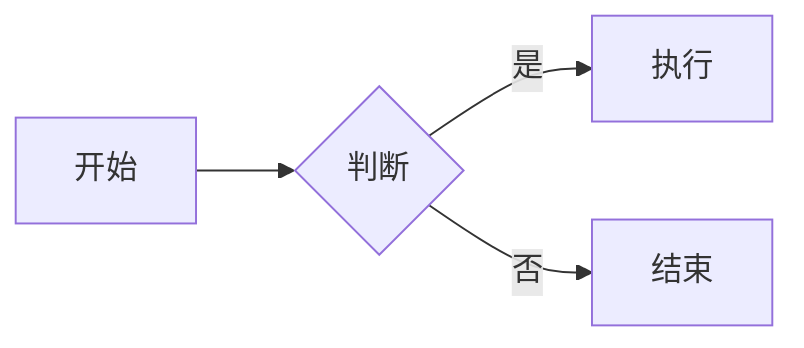

# Markdown 语法演示

> 主题回归检查用。修改 `vue.css` / `vue-dark.css` 后，用 Typora 打开本文档，浅色与深色各看一遍。
> 重点核对：标题间距、两种分隔线、代码块横向滚动、六列表格、引用块内部排版、markdown 围栏取色。

## 1. 标题层级

下面第一个是一级标题。正文里重复出现 h1 时，它应当与上文拉开距离，而不是贴在上一段下面。

# 一级标题

## 二级标题

### 三级标题

#### 四级标题

##### 五级标题

###### 六级标题

## 2. 段落与行内格式

这是一个普通段落。段落之间用空行分隔，行高、字距与颜色分别由 `--vc-leading` 与 `body` 的 `letter-spacing` 控制。

这是第二个段落，用来检查段间距。行内元素依次为：**粗体**、*斜体*、***粗斜体***、~~删除线~~、==高亮==、`行内代码`、<kbd>Ctrl</kbd> + <kbd>Shift</kbd>、上标 x^2^、下标 H~2~O。

行尾加两个空格可以强制换行：  
这一行与上一行同属一个段落，检查行距是否一致。

## 3. 列表

- 无序列表第一项
- 第二项，带行内代码 `npm install`
  - 第二层
    - 第三层
- 第四项

1. 有序列表第一项
2. 第二项
3. 第三项

任务列表：

- [x] 已完成的任务
- [ ] 未完成的任务
- [ ] 另外一条比较长的任务，用来检查换行之后的行距与缩进是否对齐

## 4. 引用

> 单层引用，检查字号、字重、底色、圆角与左侧竖线。
>
> 第二段，检查引用内部多段之间是否留出间距。

> 外层引用
>
> > 嵌套引用，检查底色加深与缩进层级。

> 引用里的代码块：
>
> ```js
> const message = 'Hello'
> ```

## 5. 代码

行内代码 `vue`、`ref()`、`<script setup>` 与正文混排时的基线。

```js
// JavaScript：关键字、字符串、数字、注释
import { createApp, ref } from 'vue'

const message = ref('Hello Vue!')
createApp({
  setup() {
    return { message }
  }
}).mount('#app')
```

```html
<!-- 一行很长的 HTML，用来检查横向滚动而不是折行 -->
<div id="app">{{ message }}</div><script type="module">import { createApp } from 'https://unpkg.com/vue@3/dist/vue.esm-browser.js'; createApp({ setup() { return {} } }).mount('#app')</script>
```

```bash
npm create vue@latest
npm install
npm run dev
```

```markdown
# Markdown 语法演示

这是一份演示 Markdown 常用语法的文档。

## 二级标题

### 三级标题

- **粗体**、*斜体*、~~删除线~~、`行内代码`
- [Vue 快速上手](https://cn.vuejs.org/guide/quick-start.html)

> 引用与分隔线一并检查取色。

---
```

## 6. 表格

| 方式 | 代码 | 规则 |
| --- | --- | --- |
| 均摊 | `EVEN` | 总额平均分摊到所有参与人 |
| 权重 | `WEIGHT` | 按指定权重比例分摊 |

六列的顶层表格会触发加宽逻辑：

| 列 1 | 列 2 | 列 3 | 列 4 | 列 5 | 列 6 |
| --- | --- | --- | --- | --- | --- |
| 内容 | 内容 | 内容 | 内容 | 内容 | 内容 |

## 7. 链接与图片

正文链接：[Vue 快速上手](https://cn.vuejs.org/guide/quick-start.html)、[相对链接](#6-表格)。检查默认颜色与 hover。


## 8. 分隔线

上面是段落，下面是一条 `---`。

---

下面是分隔线之后的内容。它应当与 h2 上方的整行分隔线明显不同：短线居中、颜色略深。

## 9. 数学公式

行内公式 $E = mc^2$ 与 $\sum_{i=1}^{n} i = \frac{n(n+1)}{2}$。

$$
\int_{-\infty}^{\infty} e^{-x^2}\,\mathrm{d}x = \sqrt{\pi}
$$

再放一个很宽的公式，检查是横向滚动还是溢出正文：

$$
f(x) = a_0 + a_1 x + a_2 x^2 + a_3 x^3 + \cdots + a_n x^n + \frac{1}{1 + e^{-x}} + \sum_{k=0}^{\infty} \frac{x^k}{k!}
$$

## 10. 脚注

这里引用一个脚注[^1]，再引用第二个[^2]。

[^1]: 脚注内容，检查字号、颜色与缩进。
[^2]: 第二条脚注。

## 11. 目录

[TOC]

## 12. Mermaid 与原始 HTML



<div style="padding: 12px 16px; border: 1px solid #ddd; border-radius: 8px;">
  原始 HTML 块：检查字体、行高与边框是否跟随主题。
</div>
